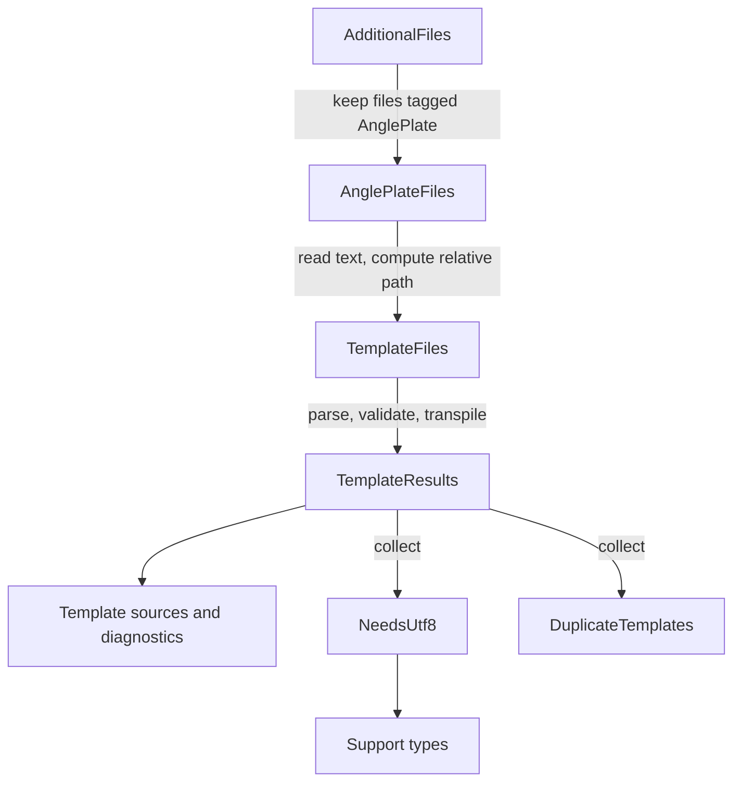

# Developing AnglePlates

AnglePlates turns template files into C# classes while the consumer's project compiles. It's a Roslyn incremental source generator plus a pair of MSBuild files, packed as an analyzer-only NuGet package. Because the compiled templates and their support types are emitted into the consumer's assembly, the consumer never ships AnglePlates itself.

This guide is for engineers who want to change AnglePlates. It follows one template from text to generated class, then shows how the generator coordinates many templates, how MSBuild hands templates to the generator, and how to build, test, and validate a change. The [README](../README.md) covers what consumers see, the [lexicon](lexicon.md) defines the project's terms, and the [roadmap](roadmap.md) lists known defects and planned work.

## Set up the repository

Use a stable .NET 10 SDK. [global.json](../global.json) sets a 10.0.100 minimum, allows later installed .NET 10 feature bands, and selects Microsoft.Testing.Platform as the test runner.

`AnglePlates.slnx` holds three projects:

- `src/AnglePlates`, the generator. It targets `netstandard2.0` and Roslyn 4.14.0 so that it loads in the compiler hosts consumers use. Its assembly name, package ID, and root namespace are all `SlusserLabs.AnglePlates`.
- `samples/HelloWorld`, a console app that uses the generator from source and checks that both renderers produce the same output.
- `tests/AnglePlates.Tests`, the TUnit test project.

Restore, build, test, and run the sample from the repository root:

```powershell
dotnet restore AnglePlates.slnx
dotnet build AnglePlates.slnx --no-restore
dotnet test --solution AnglePlates.slnx --no-build
dotnet run --project samples/HelloWorld --no-build --no-launch-profile
```

The sample sets `EmitCompilerGeneratedFiles`, so after a build you can read the generated classes under `samples/HelloWorld/obj/GeneratedFiles`. That's the quickest way to see what a change does to emitted code. Don't edit those files; they're overwritten by the next build.

## From one template to one class

The smallest useful thing AnglePlates does is turn the text of one template into C# source for one generation target. Three steps do that work, and none of them knows about Roslyn's incremental pipeline or MSBuild.

> [!NOTE]
> This sketch leaves out diagnostics, the check for files without directives, and hint names. `TemplateGenerator.ProcessTemplate` has the full version.

```csharp
// 1. Split the text into directive, literal, C# variable, C# block, and comment tokens
var parseResult = new TemplateParser(TemplateParserOptions.Default).Parse(content.AsSpan());

// 2. Read and validate the directives (#type, #model, #namespace, #generate, #access, #using)
var directiveTokens = parseResult.Tokens.Where(token => token.Type == TokenType.Directive).ToList();
var options = TemplateTranspilerOptions.Create(path, content.AsSpan(), directiveTokens, parseResult.DirectiveSectionEnd, TemplateParserOptions.Default.Whitespace);

// 3. Emit one class for each generation target the directives allow
foreach (var target in new[] { GenerationTarget.Text, GenerationTarget.Utf8 })
{
    if ((options.GenerationTarget & target) != 0)
    {
        var source = TemplateTranspiler.Transpile(relativePath, path, lines, options, target, content.AsSpan(), parseResult.Tokens);
        // Add the source to the compilation
    }
}
```

### Parsing

`TemplateParser` reads the template with `SpanReader` and produces a flat list of `Token` values, each tagged with a `TokenType`. Directive lines come first and end at the first line that isn't a known directive. After that, the parser finds the `[[ ]]`, `[% %]`, and `[* *]` delimiters, applies trim markers, and handles escaped openers. A block that never closes becomes a parse error instead of an exception.

The parser doesn't understand C#. A closing delimiter inside a C# string still ends the block, which the README documents as a limitation.

### Directives

`TemplateTranspilerOptions.Create` turns directive tokens into the class name, model type, namespace, generation target, accessibility, and `#using` list. It also collects errors for missing, repeated, and invalid directives. When a template has any parse or directive errors, the generator reports them and skips that template, so one broken template doesn't stop the rest of the project from building.

### Emitting C#

`TemplateTranspiler.Transpile` writes one class for one target. Text classes derive from `TextTemplate<TModel>` and write to a `TextWriter`. UTF-8 classes derive from `Utf8Template<TModel>`, write UTF-8 string literals to an `IBufferWriter<byte>`, and gain `RenderAsync`. Literal text becomes literal writes, C# variables become encoded writes, and C# blocks are copied into the render method as they are.

Emitted code follows a few rules that keep it safe to drop into any consumer project:

- Every type and static member is written with a `global::`-qualified name. The only `using` lines in a generated file come from the template's `#using` directives, and extension methods are called as static methods. That way a consumer type named `System` or `TextWriter` can't change what the generated code means.
- C# variables and C# blocks are wrapped in `#line` directives, so a compiler error in template code points at the template's path, line, and column. If you change how statements are laid out, check that those mappings still land in the right place.
- Output streams straight to the writer. Nothing buffers the whole render.

The base classes and `TemplateOptions` come from string templates in `Boilerplate.cs`. They follow the same rules as transpiled code because they're emitted into the consumer's project too.

## Coordinating many templates

`TemplateGenerator` wires the per-template work into Roslyn's incremental pipeline. Each step is a pure transformation of values that Roslyn can compare between runs, so it can skip work when nothing changed.



The generator starts from every additional file in the compilation but keeps only the ones the AnglePlates targets file tagged, before it reads any text. Files from other tools, like `PublicAPI.Shipped.txt`, are never opened. It then reads each tagged file and computes its path relative to the project folder with `TemplatePath`, which keeps generated class documentation and hint names the same on every machine.

`TemplateResults` runs the three steps from the previous section for each template on its own. Editing one template reruns only that template, and the rest stay cached. A future setting that changes how every template parses would have to become an input to this step.

Two small collected steps look across all templates. `NeedsUtf8` decides whether any template wants a UTF-8 class, because only `Utf8Template` depends on `System.IO.Pipelines` and a text-only project shouldn't get it. `DuplicateTemplates` finds templates that would produce the same hint name and numbers them in a stable order. Both values rarely change, so ordinary template edits leave them cached.

The support types depend on the `AnglePlateBaseAccessModifier` property, which `GeneratorSetting` reads and validates. An invalid value reports `SLAP009`, and the generator emits nothing at all, because a base class with the wrong accessibility isn't a safe fallback. Diagnostic IDs are defined in `DiagnosticDescriptors.cs` and documented in [diagnostics](diagnostics.md).

## How MSBuild hands over templates

The generator only sees what MSBuild gives it, and two files in `src/AnglePlates/buildTransitive` decide that.

`SlusserLabs.AnglePlates.props` loads before the consumer's project body. It defines the default `AnglePlate` item for `Templates\**\*`, sets the default `AnglePlateBaseAccessModifier`, and makes the property and the `AnglePlate` metadata visible to the compiler. Because it loads first, a consumer's `Remove` in the project file can drop the default item.

`SlusserLabs.AnglePlates.targets` runs a target just before the compiler's editorconfig is written. It adds each `AnglePlate` item to `AdditionalFiles` once, using full paths so two spellings of one file count as one, and tags it `Discovered` or `Explicit`. The generator uses that tag to tell its files from other tools' files and to decide whether a file without directives is skipped quietly or reported as `SLAP008`.

A new MSBuild option needs the same pieces: a default in the props file, a `CompilerVisibleProperty` entry so the generator can read it, and a `SLAP009` report when its value is invalid.

## Testing a change

[docs/testing.md](testing.md) explains `GeneratorTestHelper`, `RenderingTestHelper`, snapshot review, and incremental reruns in detail. A few habits matter for almost every change:

- Run the real generator through the helpers and compile the result. A change to parsing, trimming, encoding, or output should also run the generated renderers and assert the exact characters and bytes from both the text and UTF-8 paths.
- Review every changed snapshot in `tests/AnglePlates.Tests/Snapshots` by hand. Never turn on automatic acceptance.
- When a change affects caching, add an incremental test that reruns the driver and checks which steps were reused.
- When a change affects emitted names, add a compilation test with a consumer type that collides with them.

## Validating the package

The sample and the test project load the generator from source and import the discovery files directly, so a passing build doesn't prove the package works. The package has to be packed and installed somewhere that can't see the source tree.

Pack a fresh version to `artifacts/package` for each run. I use `0.1.0-alpha.local.<yyyyMMdd>.<n>`, where `<n>` goes up with each pack that day. Delete older packages from that folder first, so it only holds the version you're validating.

```powershell
dotnet pack src/AnglePlates/AnglePlates.csproj -c Release -o artifacts/package -p:PackageVersion=0.1.0-alpha.local.20261007.1
./eng/validate-package.ps1 -Version 0.1.0-alpha.local.20261007.1
```

The script restores only from `artifacts/package` into an empty package cache. It runs the [package validation project](../tests/AnglePlates.PackageTests/README.md), which installs the package, renders templates, and checks the package's contents and metadata. Then it runs each consumer in `tests/AnglePlates.PackageConsumers`. Those consumers check that `Remove` works in the project file and `Directory.Build.targets`, that it doesn't work in `Directory.Build.props`, and that discovery stops at the project that references AnglePlates. A new consumer has to be registered in the script, or it never runs.

The package itself stays analyzer-only: it's a development dependency with no runtime assets or dependencies, and its analyzer and XML documentation live under `analyzers/dotnet/cs/netstandard2.0`. Changing that contract needs compatibility testing first.

## Before you send a change

Build the solution, run the tests that cover your change, and run the sample when generation or rendering changed. Update the README when consumer-facing behavior changes, and update this guide when the repository layout or workflow changes. Keep known defects and planned work in the [roadmap](roadmap.md) instead of describing them as if they already work.
