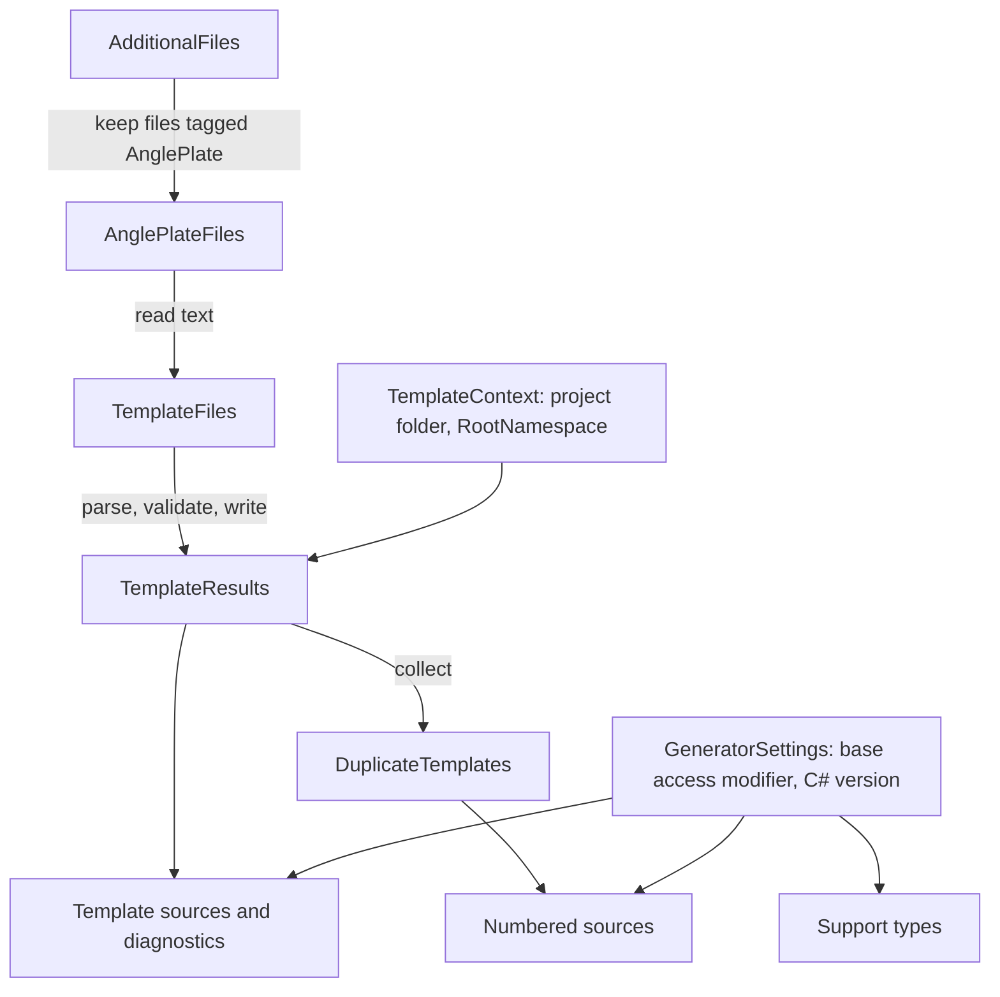

# Developing AnglePlates

AnglePlates turns template files into C# classes while the consumer's project compiles. It's a Roslyn incremental source generator plus a pair of MSBuild files, packed as an analyzer-only NuGet package. Because the compiled templates and their support types are emitted into the consumer's assembly, the consumer never ships AnglePlates itself.

This guide is for engineers who want to change AnglePlates. It follows one template from text to generated class, then shows how the generator coordinates many templates, how MSBuild hands templates to the generator, and how to build, test, and validate a change. The [README](../README.md) covers what consumers see, the [lexicon](lexicon.md) defines the project's terms, and the [roadmap](roadmap.md) lists known defects and planned work.

## Set up the repository

Use a stable .NET 10 SDK. [global.json](../global.json) sets a 10.0.100 minimum, allows later installed .NET 10 feature bands, and selects Microsoft.Testing.Platform as the test runner.

`AnglePlates.slnx` holds five projects:

- `src/AnglePlates`, the generator. It targets `netstandard2.0` and Roslyn 4.14.0 so that it loads in the .NET 10 SDK's compiler, which is the oldest host a supported consumer can use. Its assembly name, package ID, and root namespace are all `SlusserLabs.AnglePlates`.
- `samples/HelloWorld`, a console app that uses the generator from source and checks that `Render` on both renderers and `RenderAsync` produce the same output.
- `tests/AnglePlates.Tests`, the TUnit project that tests the generator with in-memory compilations.
- `tests/AnglePlates.Runtime.Tests`, a TUnit project that loads the generator the same way the sample does, compiles the real templates in its `Templates` folder, and tests the emitted classes as ordinary typed C#.
- `benchmarks/AnglePlates.Benchmarks`, a BenchmarkDotNet app that uses the generator from source. It's in the solution so changes to emitted code keep it compiling, but nothing runs it automatically. [Performance](performance.md) explains how to run it and holds the recorded baseline.

Consumers need .NET 10 and C# 11 or later. Generated code uses .NET 10 APIs and C# 11 syntax freely, without `#if` branches for anything older.

Restore, build, test, and run the sample from the repository root:

```powershell
dotnet restore AnglePlates.slnx
dotnet build AnglePlates.slnx --no-restore
dotnet test --solution AnglePlates.slnx --no-build
dotnet run --project samples/HelloWorld --no-build --no-launch-profile
```

The sample sets `EmitCompilerGeneratedFiles`, so after a build you can read the generated classes under `samples/HelloWorld/obj/GeneratedFiles`. That's the quickest way to see what a change does to emitted code. Don't edit those files; they're overwritten by the next build.

## Where the generator code lives

`src/AnglePlates` keeps `TemplateGenerator.cs`, the incremental pipeline, at its root, and groups everything else by the job it does:

| Folder | What's in it |
| --- | --- |
| `Pipeline` | The values passed between pipeline steps, such as `TemplateFile`, `TemplateContext`, `TemplateResult`, and `GeneratorSettings`, plus helpers like `TemplatePath` and `EquatableArray`. |
| `Parsing` | `TemplateParser`, `TemplateReader`, `TemplateSyntax`, `CSharpBlockScanner`, and what the parser returns: `ParsedTemplate`, `Token`, and `DirectiveToken`. |
| `Directives` | `DirectiveReader`, the `TemplateDirectives` it produces, `DirectiveSpellCheck` for `SLAP011`, and the `DirectiveKind` and `GenerationTarget` enums. |
| `Emit` | `TemplateClassWriter`, which writes template classes, and `SupportTypes`, which holds the support types' source. |
| `Diagnostics` | `DiagnosticDescriptors`, `TemplateError`, `TemplateDiagnostic`, and `UnexpectedValue`, the one helper that throws for an enum value a switch doesn't handle. |
| `build` | The MSBuild files described in [How MSBuild hands over templates](#how-msbuild-hands-over-templates). |

Each file holds one type. Every type is in the `SlusserLabs.AnglePlates` namespace, whatever its folder, which is a deliberate exception to the usual rule that folders mirror namespaces. The folders are there to help you find things. In a project this small, sub-namespaces would only add `using` lines to almost every file.

## From one template to one class

The smallest useful thing AnglePlates does is turn the text of one template into C# source for one generation target. Three steps do that work, and none of them knows about Roslyn's incremental pipeline or MSBuild.

> [!NOTE]
> This sketch leaves out diagnostics, the check for files without directives, and hint names. `TemplateGenerator.ProcessTemplate` has the full version.

```csharp
// 1. Split the text into directives and body tokens: literals, C# variables, C# blocks, and comments
var parsed = TemplateParser.Parse(content, cancellationToken);

// 2. Read and validate the directives, deriving #type and #namespace when they're left out
var errors = new List<TemplateError>();
var directives = DirectiveReader.Read(parsed, relativePath, templateContext, errors);

// 3. Write one class for each generation target the directives allow
foreach (var target in new[] { GenerationTarget.Text, GenerationTarget.Utf8 })
{
    if ((directives!.GenerationTarget & target) != 0)
    {
        var source = TemplateClassWriter.Write(relativePath, path, lines, parsed, directives, target);
        // Add the source to the compilation
    }
}
```

### Parsing

`TemplateParser.Parse` walks the text with `TemplateReader` and returns a `ParsedTemplate`. Directive lines come first and end at the first line that isn't a known directive; each one becomes a `DirectiveToken` with the span of its name and its trimmed value. After that, the parser finds the `[[ ]]`, `[% %]`, and `[* *]` delimiters, applies trim markers, and handles escaped openers. Each piece of the body becomes a `Token`, tagged with a `TokenType`, whose span covers the block's trimmed content. A block that never closes becomes a `TemplateError` instead of an exception. The parser checks for cancellation once per block.

The delimiters, the trim marker, and the whitespace set are constants in `TemplateSyntax`. They aren't configurable. Besides the parser, only the class writer (for trimming), the directive reader (to find the end of the directive section's last line), and `CSharpBlockScanner` (for the closing delimiters) use them.

C# variables and C# blocks end where `CSharpBlockScanner.FindCloser` says they do. It reads the block with Roslyn's lexer through `SyntaxFactory.ParseTokens`, starting at the block's content, and it always uses `LanguageVersion.Preview` and `DocumentationMode.None`, so the consumer's project settings don't change where a block ends. A C# variable ends at a `]` token followed right away by `]` once every `[` token in it is closed, and a C# block ends at a `%` token followed right away by `]`. Whitespace, line breaks, well-formed `/* */` comments, and string and character literals can't hold a closer. A `//` comment, a `#` directive, and any token or trivia with lexer errors end at the first closer inside them, which keeps `[% // note %]`, `[% #if DEBUG %]`, and broken C# such as an unterminated string working the way they always did. The scanner reads each `#` directive line itself, checking the whitespace and comments before every token so the lexer never sees one, and starts the lexer again on the next line. The generator can't know the consumer's preprocessor symbols, and a lexer that read `#if DEBUG` would treat the rest of the template as disabled text; doing that for every `[% #if %]` block would make parsing quadratic.

The lexer never reads the rest of the template in one go. It reads a window that ends right after the first closer the plain text search finds, and when a token or comment reaches the end of the window, the scanner starts over with a window that holds twice as many closers. A token that ends inside the window lexes the same way it would in the whole text, so valid C# gets the same answer in a window or two. Broken C#, such as a `/*` comment or a verbatim string that never ends, would otherwise send the lexer to the end of the template once for every block, and an unclosed interpolation hole like `$"{` makes Roslyn recurse one level deeper for each later `$"{`, which can overflow the stack and take the compiler down with it. After the window that holds 16 closers, the scanner gives up and returns -1.

When the scanner returns -1, the parser falls back to the plain text search for the closer. That happens when a C# variable has an unmatched `[`, when the only closer left is inside a C# string or comment, or when the C# hides more than 15 closers in strings, comments, or brackets. The first two are broken C#, and the compiler reports them through `#line`. The third ends the block early, so the compiler reports that too, at the template line where the block was cut off. If the plain search fails too, the block reports `SLAP004`. Comments aren't C#, so they always use the plain search. The class writer uses the same lexer for two more jobs: `CountBraces` indents the generated code around C# blocks without counting braces inside strings, which only affects readability, and `EndsWithLineComment` moves the code after a C# variable that ends in a `//` comment to the next line.

The generator is built against Roslyn 4.14, but at build time it runs on the compiler in the consumer's SDK, so that compiler's lexer is the one that decides. The `ScannerParity` package consumer renders the scanner cases through the packed analyzer on whatever SDK runs the validation script.

### Directives

`DirectiveReader.Read` turns the directive tokens into an immutable `TemplateDirectives` with the class name, model type, namespace, generation target, accessibility, encoding, and `#using` list. The encoding is a `TemplateEncoding` value whose names match the `TemplateOptions` presets (`#encode none` reads as `Unencoded`), so the writer emits the name as it is. Each directive kind has its own private method in the reader. When `#type` or `#namespace` is left out, the reader derives it from the template's path relative to the project folder: the class name from the file name, and the namespace from `RootNamespace` plus the folders. A name that can't be derived, a missing `#model`, and repeated or invalid directives become `TemplateError` values, and then `Read` returns `null`. Before any of that, the generator runs `DirectiveSpellCheck` on the first body line, or on the first line of a file with no directives, and reports `SLAP011` when it looks like a misspelled directive. The generator converts directive errors and parse errors in one loop. When a template has any errors, the generator reports them and skips that template, so one broken template doesn't stop the rest of the project from building.

### Emitting C#

`TemplateClassWriter.Write` writes one class for one target. It creates a writer instance that holds what every step needs (the indented writer, the template's lines and text, its directives, and its absolute path), and each part of the class has its own method: the file header, the class declaration, the constructor and `Default`, the render methods, and inside those, literal runs, C# variables, C# blocks, and `#line` mappings. Classes are `sealed partial`, so a consumer can add helper members in a hand-written half. Text classes derive from `TextTemplate<TModel>` and write to a `TextWriter`. UTF-8 classes derive from `Utf8Template<TModel>` and write UTF-8 string literals to an `IBufferWriter<byte>`. The constructor takes optional options and falls back to the preset that `#encode` picked, and `Default` is a shared instance made the same way. Each render method starts with `ArgumentNullException.ThrowIfNull(writer)`, outside any `#line` mapping, and the `Model` alias.

Literal text becomes a `WriteLiteral(..., writer)` call. A run of literal text keeps going across comments, empty blocks, and escaped openers, so `a[* c *]b` is one call; a trim marker on one of those tokens ends the run, because it trims the literal next to it. Each C# variable becomes one `Write(expression, writer);` line with one `#line` mapping, and the base class has two overloads for it. A `string`, `null`, or `default` binds `Write(string?)`. Everything else binds the unconstrained `Write<T>(T)`, which converts the value the way `Convert.ToString(value, CultureInfo.InvariantCulture)` does (`IConvertible`, then `IFormattable`, then `ToString()`) without boxing most value types. Because `Write<T>` has no constraint, the runtime binder can bind a `dynamic` value of any type to it. A variable that isn't a single argument, such as `[[1, 2]]`, becomes `Write(1, 2, writer)` and fails to compile at the template location. C# blocks are copied into the render method as they are.

### Two render methods from one walk

A UTF-8 class gets two methods: `Render`, which writes to an `IBufferWriter<byte>`, and `RenderAsync`, which writes to a `PipeWriter` and flushes it while it renders. Both come from `TemplateClassWriter.WriteRenderMethod`, which walks the body tokens once per method. An `isAsync` switch changes three things and nothing else: the signature, one unconditional `FlushAsync` at the end, and how a flush check is spelled.

A flush check is fused into the first write after each C# block. The walk only remembers whether the previous token it emitted was a C# block, so there's no lookahead. Here's the end of a `RenderAsync` for `[% foreach (var row in model.Rows) { %]<li>[[ row ]]</li>[% } %]</ul>`:

> [!NOTE]
> This excerpt leaves out the `#line` directives.

```csharp
foreach (var row in model.Rows) {
    // The first write after a C# block carries a flush check
    await WriteLiteralAsync("<li>"u8, writer, cancellationToken).ConfigureAwait(false);

    // Ordinary writes, the same as in Render
    Write(row, writer);
    WriteLiteral("</li>"u8, writer);
}

await WriteLiteralAsync("</ul>"u8, writer, cancellationToken).ConfigureAwait(false);

// Every render ends with one unconditional flush
await FlushAsync(writer, cancellationToken).ConfigureAwait(false);
```

Loops and child template calls live in C# blocks, so that's where output can grow without bound. Every loop iteration that writes anything starts with a write that follows a C# block, so every such iteration passes a check. The writes between two C# blocks are fixed by the template, so they need no checks of their own. Each check is one statement, because templates can wrap a write in brace-less C# such as `[% if (x) %]a[% else %]b`.

The checks call helpers on `Utf8Template<TModel>`. `WriteLiteralAsync` writes a UTF-8 literal, and `WriteAsync` mirrors the four `Write` overloads and calls them. Each one writes, then checks the cancellation token and flushes only once 16 KB are waiting, so most checks complete synchronously and don't suspend the method. `FlushAsync` turns a flush result that reports a completed reader or a canceled flush into an `OperationCanceledException`, which unwinds nested C# blocks and child templates without any generated code. The threshold is a private constant.

The base classes keep their surface small. `Options`, `Render`, and `RenderAsync` are public. `Write` and `WriteRaw` are `protected`, because template C# calls them. The constructors, `WriteLiteral`, `WriteLiteralAsync`, `WriteAsync`, and `FlushAsync` are `private protected`: compiled templates always live in the same assembly as their support types, so they can call them, but another assembly that derives from public support types can't.

Because C# blocks also land in an async method, a UTF-8 template can't hold a ref struct local across a flush check or put a check inside `lock` or `unsafe`. The generator doesn't look for these; the compiler reports them at the template location, and the README lists the errors.

Emitted code follows a few rules that keep it safe to drop into any consumer project:

- Every type and static member is written with a `global::`-qualified name. The only `using` lines in a generated file come from the template's `#using` directives, and extension methods are called as static methods. That way a consumer type named `System` or `TextWriter` can't change what the generated code means.
- C# variables, C# blocks, and the literal writes that carry a flush check are wrapped in `#line` directives, so a compiler error in template code points at the template's path, line, and column. The directive's character offset is 0-based and points at the first character of the template code on the generated line, so an error inside the code maps to its exact span, and an error in the call around a C# variable, which starts before that offset, maps to the whole variable. An error in either render method maps to the same template location, so a UTF-8 class can report the same error twice. If you change how statements are laid out, check that those mappings still land in the right place.
- Output streams straight to the writer. Nothing buffers the whole render.

The base classes, `TemplateOptions`, and `TemplateExtensions` come from raw string literals in `Emit/SupportTypes.cs`, one method per type. `TemplateOptions` is `sealed` with `init`-only properties and four presets (`Html`, `Unencoded`, `JavaScript`, and `Url`). `Write` hands encoding to the framework: the text target calls `encoder.Encode(writer, value)`, and the UTF-8 target encodes to a string and writes it as UTF-8. `TemplateExtensions` holds the `RenderToString` extension method. Every emitted member has XML documentation, and the `cref`s avoid keyword type arguments such as `IBufferWriter{byte}`, which warn under `GenerateDocumentationFile`; `DocumentationModeTests` checks this. They follow the same rules as template classes because they're emitted into the consumer's project too. Their snapshot in `SupportTypesSnapshotTests` is the contract, so any change to those strings shows up there for review.

## Coordinating many templates

`TemplateGenerator` wires the per-template work into Roslyn's incremental pipeline. Each step is a pure transformation of values that Roslyn can compare between runs, so it can skip work when nothing changed. That only works if every value passed between steps compares by value: a string, an enum, a record of those, or an `EquatableArray`. Nothing in the pipeline may hold a `Compilation`, `SyntaxTree`, or `SourceText`, because those never compare equal between runs and would rerun every step after them. `Initialize` states this rule at the top and lays the pipeline out as numbered steps.



The generator starts from every additional file in the compilation but keeps only the ones the AnglePlates targets file tagged, before it reads any text. Files from other tools, like `PublicAPI.Shipped.txt`, are never opened. It then reads each tagged file into a `TemplateFile`.

`TemplateResults` runs the three steps from the previous section for each template on its own, with the `TemplateFile` and a `TemplateContext` as its input. Editing one template reruns only that template, and the rest stay cached. `TemplateContext` holds the project values that every template needs: the project folder and `RootNamespace`. `TemplatePath` uses the folder to turn the template's full path into a path relative to the project folder, which keeps the generated class documentation and the `<auto-generated>` header the same on every machine. The header names that relative path and no version number, so a package update doesn't touch every generated file. The relative path and `RootNamespace` are also where a derived `#type` and `#namespace` come from. Changing either value reruns every template but leaves the file reads and the support types cached. A future setting that changes how every template is read belongs in `TemplateContext` too.

Three output methods turn the results into sources. `AddSupportTypes` adds the support types. `AddTemplateSources` reports each template's diagnostics and adds its sources. It also decides `SLAP005`, because it's the step that sees both a public template and the support types' access modifier. `AddNumberedSources` adds the sources whose hint names collide, and it skips public classes the same way when the support types are internal.

Each generated file is named after the class it declares, so a text template for `MyApp.Templates.Greeting` becomes `MyApp.Templates.GreetingTextTemplate.g.cs`, and the support types become `SlusserLabs.AnglePlates.TemplateOptions.g.cs` and so on. Roslyn compares these hint names without case and throws on a repeat, so one small collected step looks across all templates. `DuplicateTemplates` finds sources whose names match when case is ignored, sorts them by template path, and numbers the second and later ones `.2`, `.3`, and so on, as in `MyApp.Templates.GreetingTextTemplate.2.g.cs`. Two templates that declare the same class still compile into conflicting members, so the compiler reports those errors; classes that differ only by case, like `App.Page` and `app.page`, are legal and only get numbered names. The step rarely changes, so ordinary template edits leave it cached.

Every project that imports the package props gets all four support types, whatever its templates generate. .NET 10 includes `System.IO.Pipelines` in the base framework, so `Utf8Template` costs a text-only project nothing it has to reference, and trimming removes the types an app doesn't use. The support types depend only on `GeneratorSettings`: the `AnglePlatePropsImported` marker, the `AnglePlateBaseAccessModifier` property, which `GeneratorSetting` reads and validates, and the C# version from the parse options. Without the marker, the generator emits nothing and reports nothing, as [How MSBuild hands over templates](#how-msbuild-hands-over-templates) explains. An invalid property value reports `SLAP009` and a C# version below 11 reports `SLAP010`. Either one stops the generator from emitting anything at all, because a base class with the wrong accessibility isn't a safe fallback and code for an older C# version would only produce errors inside generated files. Diagnostic IDs are defined in `Diagnostics/DiagnosticDescriptors.cs` and documented in [diagnostics](diagnostics.md).

## How MSBuild hands over templates

The generator only sees what MSBuild gives it, and two files in `src/AnglePlates/build` decide that. The package ships them in its `build` folder, so NuGet imports them only into the project that references AnglePlates. Templates compile only where the generator runs, so a project further down the reference chain has no use for them. Before 1.0 they shipped in `buildTransitive`, which also imported them into projects that referenced the consumer, and those projects got template discovery without a generator to read the files.

The opposite leak is still possible. A library that references AnglePlates without `PrivateAssets="all"` passes the analyzer on to every project that references the library, but not the `build` files. That project can't have templates, because both the default item and explicit `AnglePlate` items need the props and targets. So the props set `AnglePlatePropsImported` to `true` and make it visible to the compiler, and the generator emits no sources and no diagnostics, `SLAP009` and `SLAP010` included, unless it reads `true` there. Without that check, the generator would add `internal` support types that collide with the library's public ones as `CS0436` warnings. The `NoPrivateAssets` package consumer covers this case.

`SlusserLabs.AnglePlates.props` loads before the consumer's project body. It sets `AnglePlatePropsImported` to `true`, sets `AnglePlateBaseAccessModifier` to `internal` and `EnableDefaultAnglePlateItems` to `true` when the project leaves them empty (matching the generator's own default for the first), defines the default `AnglePlate` item for `Templates\**\*` when `EnableDefaultAnglePlateItems` is `true`, and makes the marker, the access modifier, `RootNamespace`, and the `AnglePlate` metadata visible to the compiler. MSBuild evaluates every property before any item, so setting `EnableDefaultAnglePlateItems` to `false` turns off the default item from the project file or from `Directory.Build.props`. A `Remove` only works after the item exists, so it works in the project file and `Directory.Build.targets` but not in `Directory.Build.props`.

`SlusserLabs.AnglePlates.targets` runs a target just before the compiler's editorconfig is written. It adds each `AnglePlate` item to `AdditionalFiles` once, using full paths so two spellings of one file count as one, and tags it `Discovered` or `Explicit`. The generator uses that tag to tell its files from other tools' files and to decide whether a file without directives is skipped quietly or reported as `SLAP008`.

A new MSBuild option needs the same pieces: a default in the props file, a `CompilerVisibleProperty` entry so the generator can read it, and a `SLAP009` report when its value is invalid.

## Testing a change

[docs/testing.md](testing.md) explains `GeneratorTestHelper`, `RenderingTestHelper`, snapshot review, and incremental reruns in detail. A few habits matter for almost every change:

- Run the real generator through the helpers and compile the result. A change to parsing, trimming, encoding, or output should also run the generated renderers and assert the exact characters and bytes from both the text and UTF-8 paths.
- Test how the emitted classes behave at run time in `tests/AnglePlates.Runtime.Tests`: add a template under its `Templates` folder and call the generated class directly. Its `ConversionTests` pin how every common C# variable type turns into text, so a change to the support types has to keep them passing.
- Review every changed snapshot in `tests/AnglePlates.Tests/Snapshots` by hand. Never turn on automatic acceptance.
- When a change affects caching, add an incremental test that reruns the driver and checks which steps were reused.
- When a change affects emitted names, add a compilation test with a consumer type that collides with them.

## Validating the package

The sample and both test projects load the generator from source, and the sample and `AnglePlates.Runtime.Tests` import the discovery files directly, so a passing build doesn't prove the package works. The package has to be packed and installed somewhere that can't see the source tree.

Pack a fresh version to `artifacts/package` for each run, using the local format from the [version table](releasing.md#versions): `1.0.0-local.<yyyyMMdd>.<n>`, where `<n>` goes up with each pack that day. Delete older packages from that folder first, so it only holds the version you're validating. Pass `-p:Version`, not `-p:PackageVersion`; the second one changes the package version but leaves the assembly versions behind.

```powershell
dotnet pack src/AnglePlates/AnglePlates.csproj -c Release -o artifacts/package -p:Version=1.0.0-local.20261013.1
./eng/validate-package.ps1 -Version 1.0.0-local.20261013.1
```

The script needs PowerShell 7.4 or later. It builds every consumer in one validation folder with an empty package cache and one generated `NuGet.config`. That configuration uses package source mapping, so AnglePlates comes only from `artifacts/package`, a library that a consumer packs comes only from the validation folder's own feed, and everything else (the Native AOT compiler and runtime packs, mostly) comes from nuget.org. The validation folder also gets a copy of the repository's `global.json`, and every `dotnet` command runs from there, so the consumers use the same SDK the repository does. The script prints that SDK version before it starts.

It runs the [package validation project](../tests/AnglePlates.PackageTests/README.md) first, which installs the package, renders templates, and checks the package's contents, metadata, and the assets the consumer gets. The README is the package page on nuget.org, which doesn't resolve relative paths, so the validation project also fails on any README link or image that isn't an absolute `https://` URL or a `#anchor`, on images from hosts nuget.org doesn't trust, and on leftover `# TODO` or `TODO:` lines. It checks that `icon.png` is a square PNG between 128 and 512 px and no bigger than 100 KB. Then it runs each consumer in `tests/AnglePlates.PackageConsumers`. They cover discovery and its switches, project and package chains, central package management, derived names, the scanner, ASP.NET Core streaming, builds that must fail, an older framework, and Native AOT. A new consumer has to be registered in the script, or it never runs. The [package validation README](../tests/AnglePlates.PackageTests/README.md) has the one table of what each consumer checks.

Most consumers just restore and `dotnet run`, and the program checks its own output. A few need more, and the script handles them:

- `PackagedLibrary` packs its library into the validation folder's feed first, then restores the app from it.
- `RemoveDefault` runs three times. After the first run, the script edits one of its templates, and `dotnet run` rebuilds in place and must show the new text. Then the script deletes that template, and the next run must find the class gone.
- `BuildErrors` and `UnsupportedFramework` must fail to build. Each project has an `ExpectedErrors.txt`, and the script requires a nonzero exit and every line in that file, after it turns absolute paths into project-relative ones. `UnsupportedFramework` also fails on any error or warning the file doesn't list, except the SDK's `NETSDK1138` end-of-support warning for `net8.0`, which the script ignores because newer SDKs add it once .NET 8 is out of support. Each `BuildErrors` case is a folder with a project of the same name and an optional `BuildArguments.txt`.
- `NativeAot` first checks that `EnableTrimAnalyzer`, `EnableAotAnalyzer`, and `IlcTreatWarningsAsErrors` evaluate to `true`, so a clean publish actually means something. It runs with `dotnet run` like the others, then publishes with `PublishAot` and runs the native executable, because `dotnet run` never invokes the AOT compiler. Both runs check the same exact bytes. The script prints the executable's size, and it stops with a named error if the publish doesn't produce one. Last comes the AOT canary: a publish with `-p:AotCanary=true` adds a template with a `dynamic` C# variable, and the script requires that publish to fail with `IL2026` or `IL3050`.

The script takes a few options besides `-Version`:

| Option | What it does |
| --- | --- |
| `-PackageDirectory <path>` | Reads the package pair from somewhere other than `artifacts/package`. |
| `-KeepOutput <path>` | Keeps the validation folder at that path instead of deleting a temporary one. The folder has to be new or empty and outside the repository, so the consumers don't pick up the repository's `Directory.Build.props`; a relative path resolves against the current PowerShell location. Every restore, build, and publish writes a binlog to its `logs` folder, which is the first place to look when a consumer fails. CI passes `$RUNNER_TEMP/validation`. |
| `-ExpectedCommit <sha>` | Fails unless the package records that commit in its nuspec `repository` element. It doesn't look for a `branch` attribute, because tag builds don't have one. |
| `-SdkVersion <version>` | Writes a `global.json` that pins exactly that SDK (`rollForward` set to `disable`) instead of copying the repository's. The SDK has to be installed. CI's `sdk-floor` leg uses it with `10.0.100`. |
| `-Source <feed>` | Restores AnglePlates from a feed instead of `artifacts/package`, to validate a package that's already published. The validation project checks the copy NuGet downloaded into the package cache. There's no symbol package to check in that case, so it skips the `.snupkg` checks. |
| `-SkipNativeAot` | Skips the native publish of the `NativeAot` consumer on a machine without the native toolchain. Its JIT run and the AOT canary still run. |

Native AOT needs a platform toolchain that the .NET SDK doesn't install: the Visual Studio "Desktop development with C++" workload on Windows, or clang and the zlib development headers on Linux. The script checks for it before running anything and stops with a message that names what's missing. Pass `-SkipNativeAot` to validate everything else; the script then warns that the native publish didn't run. The canary doesn't need the toolchain, because the analyzers stop it while it compiles. CI runs the native publish and the canary on both the `windows` and `ubuntu` legs, because `windows-latest` runners come with the C++ workload.

Run the script on Linux as well as Windows, so `TemplatePath` and the MSBuild files see Unix paths. If you don't have a Linux machine, the `mcr.microsoft.com/dotnet/sdk:10.0-noble-aot` container has PowerShell, the SDK, and the Native AOT prerequisites. Mount the repository after packing on the host:

```powershell
docker run --rm -v "${PWD}:/repo:ro" mcr.microsoft.com/dotnet/sdk:10.0-noble-aot pwsh -File /repo/eng/validate-package.ps1 -Version 1.0.0-local.20261013.1
```

The package itself stays analyzer-only: it's a development dependency with no runtime assets or dependencies, and its analyzer and XML documentation live under `analyzers/dotnet/cs/netstandard2.0`. Changing that contract needs compatibility testing first.

### Supported frameworks

The README says AnglePlates needs .NET 10, and that's a support statement, not a check. Before 1.0, the support types and the `NativeAot` consumer's templates and checks (text and UTF-8 classes, a child template, `RenderAsync`, `RenderToString`, and the options presets) were built against the .NET 8 and .NET 9 reference packs to find out whether a check was needed. On .NET 9 everything compiled and rendered the expected bytes. On .NET 8, the only missing API was `System.IO.Pipelines`: `PipeWriter` and `FlushResult`, which `Utf8Template` uses for `RenderAsync` and which aren't in the .NET 8 reference pack. With the `System.IO.Pipelines` package added, the .NET 8 build passed the same checks. Every other API the generated code calls, such as `ArgumentNullException.ThrowIfNull`, the span overloads of `Encoding`, and `System.Text.Encodings.Web`, exists in .NET 8.

The generated code needs nothing that only .NET 10 has, so there's no `SLAP012` diagnostic for an unsupported framework. Today .NET 8 fails with the compiler's own errors, and .NET 9 builds without any. The `UnsupportedFramework` consumer pins exactly which ones: a `net8.0` build has to fail with `CS0234` for `System.IO.Pipelines` and nothing else. If generated code starts calling an API that .NET 8 or 9 lacks, that consumer fails, and it's time to decide again whether `SLAP012` should exist. None of this widens the supported range. .NET 9 technically works, but it isn't tested on every change, so .NET 10 stays the supported floor, and .NET 8 isn't tested beyond this compile check.

## Updating the icon

`icon.svg` at the repository root is the source for the package icon. It's hand-editable: every face is one flat-colored polygon, and the colors live in its `<style>` block. The package never ships the SVG, because NuGet icons have to be PNG or JPEG. It ships `icon.png`, a 256x256 render. After you change the SVG, render it again from the repository root:

```powershell
uv run --with resvg-py==0.5.0 python -c "import resvg_py; open('icon.png','wb').write(bytes(resvg_py.svg_to_bytes(svg_path='icon.svg', width=256, height=256)))"
```

Look at the result at 128 and 32 px on both light and dark backgrounds before you commit it. Package lists and search results show the icon small, and detail that reads fine at 256 px can turn to mush at 32. Package validation fails if the PNG isn't square, is outside 128 to 512 px, or is over 100 KB.

## Measuring performance

`benchmarks/AnglePlates.Benchmarks` compares compiled templates with hand-written code that produces the same output. Each benchmark's setup renders both and fails if they differ, so a change to emitted code can't quietly turn a comparison into nonsense. [Performance](performance.md) explains how to run the benchmarks and records the current numbers and Native AOT sizes. Measure before and after any change that's meant to make rendering faster, and don't claim a speedup the numbers don't show.

## Before you send a change

Build the solution, run the tests that cover your change, and run the sample when generation or rendering changed. Update the README when consumer-facing behavior changes, and update this guide when the repository layout or workflow changes. Keep known defects and planned work in the [roadmap](roadmap.md) instead of describing them as if they already work.
