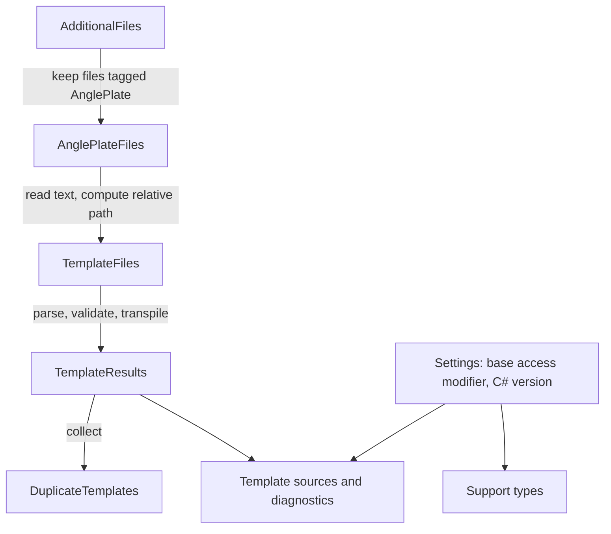

# Developing AnglePlates

AnglePlates turns template files into C# classes while the consumer's project compiles. It's a Roslyn incremental source generator plus a pair of MSBuild files, packed as an analyzer-only NuGet package. Because the compiled templates and their support types are emitted into the consumer's assembly, the consumer never ships AnglePlates itself.

This guide is for engineers who want to change AnglePlates. It follows one template from text to generated class, then shows how the generator coordinates many templates, how MSBuild hands templates to the generator, and how to build, test, and validate a change. The [README](../README.md) covers what consumers see, the [lexicon](lexicon.md) defines the project's terms, and the [roadmap](roadmap.md) lists known defects and planned work.

## Set up the repository

Use a stable .NET 10 SDK. [global.json](../global.json) sets a 10.0.100 minimum, allows later installed .NET 10 feature bands, and selects Microsoft.Testing.Platform as the test runner.

`AnglePlates.slnx` holds four projects:

- `src/AnglePlates`, the generator. It targets `netstandard2.0` and Roslyn 4.14.0 so that it loads in the .NET 10 SDK's compiler, which is the oldest host a supported consumer can use. Its assembly name, package ID, and root namespace are all `SlusserLabs.AnglePlates`.
- `samples/HelloWorld`, a console app that uses the generator from source and checks that `Render` on both renderers and `RenderAsync` produce the same output.
- `tests/AnglePlates.Tests`, the TUnit test project.
- `benchmarks/AnglePlates.Benchmarks`, a BenchmarkDotNet app that uses the generator from source. It's in the solution so changes to emitted code keep it compiling, but nothing runs it automatically. [Performance](performance.md) explains how to run it and holds the recorded baseline.

Consumers need .NET 10 and C# 11 or later. Generated code uses .NET 10 APIs and C# 11 syntax freely, without `#if` branches for anything older.

Restore, build, test, and run the sample from the repository root:

```powershell
dotnet restore AnglePlates.slnx
dotnet build AnglePlates.slnx --no-restore
dotnet test --solution AnglePlates.slnx --no-build
dotnet run --project samples/HelloWorld --no-build --no-launch-profile
```

The sample sets `EmitCompilerGeneratedFiles`, so after a build you can read the generated classes under `samples/HelloWorld/obj/GeneratedFiles`. That's the quickest way to see what a change does to emitted code. Don't edit those files; they're overwritten by the next build.

## From one template to one class

The smallest useful thing AnglePlates does is turn the text of one template into C# source for one generation target. Three steps do that work, and none of them knows about Roslyn's incremental pipeline or MSBuild.

> [!NOTE]
> This sketch leaves out diagnostics, the check for files without directives, and hint names. `TemplateGenerator.ProcessTemplate` has the full version.

```csharp
// 1. Split the text into directive, literal, C# variable, C# block, and comment tokens
var parseResult = new TemplateParser(TemplateParserOptions.Default).Parse(content.AsSpan());

// 2. Read and validate the directives (#type, #model, #namespace, #generate, #access, #using)
var directiveTokens = parseResult.Tokens.Where(token => token.Type == TokenType.Directive).ToList();
var options = TemplateTranspilerOptions.Create(path, content.AsSpan(), directiveTokens, parseResult.DirectiveSectionEnd, TemplateParserOptions.Default.Whitespace);

// 3. Emit one class for each generation target the directives allow
foreach (var target in new[] { GenerationTarget.Text, GenerationTarget.Utf8 })
{
    if ((options.GenerationTarget & target) != 0)
    {
        var source = TemplateTranspiler.Transpile(relativePath, path, lines, options, target, content.AsSpan(), parseResult.Tokens);
        // Add the source to the compilation
    }
}
```

### Parsing

`TemplateParser` reads the template with `SpanReader` and produces a flat list of `Token` values, each tagged with a `TokenType`. Directive lines come first and end at the first line that isn't a known directive. After that, the parser finds the `[[ ]]`, `[% %]`, and `[* *]` delimiters, applies trim markers, and handles escaped openers. A block that never closes becomes a parse error instead of an exception.

The parser doesn't understand C#. A closing delimiter inside a C# string still ends the block, which the README documents as a limitation.

### Directives

`TemplateTranspilerOptions.Create` turns directive tokens into the class name, model type, namespace, generation target, accessibility, and `#using` list. It also collects errors for missing, repeated, and invalid directives. When a template has any parse or directive errors, the generator reports them and skips that template, so one broken template doesn't stop the rest of the project from building.

### Emitting C#

`TemplateTranspiler.Transpile` writes one class for one target. Text classes derive from `TextTemplate<TModel>` and write to a `TextWriter`. UTF-8 classes derive from `Utf8Template<TModel>` and write UTF-8 string literals to an `IBufferWriter<byte>`. Literal text becomes literal writes, C# variables become encoded writes, and C# blocks are copied into the render method as they are.

### Two render methods from one walk

A UTF-8 class gets two methods: `Render`, which writes to an `IBufferWriter<byte>`, and `RenderAsync`, which writes to a `PipeWriter` and flushes it while it renders. Both come from the same local function in `Transpile`, which walks the tokens once per method. An `isAsync` switch changes three things and nothing else: the signature, one unconditional `FlushAsync` at the end, and how a flush check is spelled.

A flush check is fused into the first write after each C# block. The walk only remembers whether the previous token it emitted was a C# block, so there's no lookahead. Here's the end of a `RenderAsync` for `[% foreach (var row in model.Rows) { %]<li>[[ row ]]</li>[% } %]</ul>`:

> [!NOTE]
> This excerpt leaves out the `#line` directives and shortens the pattern variable's name.

```csharp
foreach (var row in model.Rows) {
    // The first write after a C# block carries a flush check
    await WriteAsync("<li>"u8, writer, cancellationToken).ConfigureAwait(false);

    // Ordinary writes, the same as in Render
    Write((row) is { } value ? global::System.Convert.ToString(value, global::System.Globalization.CultureInfo.InvariantCulture) : null, writer);
    global::System.Buffers.BuffersExtensions.Write(writer, "</li>"u8);
}

await WriteAsync("</ul>"u8, writer, cancellationToken).ConfigureAwait(false);

// Every render ends with one unconditional flush
await FlushAsync(writer, cancellationToken).ConfigureAwait(false);
```

Loops and child template calls live in C# blocks, so that's where output can grow without bound. Every loop iteration that writes anything starts with a write that follows a C# block, so every such iteration passes a check. The writes between two C# blocks are fixed by the template, so they need no checks of their own. Each check is one statement, because templates can wrap a write in brace-less C# such as `[% if (x) %]a[% else %]b`.

The checks call helpers on `Utf8Template<TModel>`. `WriteAsync` has one overload per existing write kind, a UTF-8 literal and an encoded string, and the string overload goes through the same `Write` as everything else. Both write, then check the cancellation token and flush only once 16 KB are waiting, so most checks complete synchronously and don't suspend the method. `FlushAsync` turns a flush result that reports a completed reader or a canceled flush into an `OperationCanceledException`, which unwinds nested C# blocks and child templates without any generated code. The threshold is a private constant. Every helper is `protected` or `private`; `RenderAsync` is the only public member.

Because C# blocks also land in an async method, a UTF-8 template can't hold a ref struct local across a flush check or put a check inside `lock` or `unsafe`. The generator doesn't look for these; the compiler reports them at the template location, and the README lists the errors.

Emitted code follows a few rules that keep it safe to drop into any consumer project:

- Every type and static member is written with a `global::`-qualified name. The only `using` lines in a generated file come from the template's `#using` directives, and extension methods are called as static methods. That way a consumer type named `System` or `TextWriter` can't change what the generated code means.
- C# variables, C# blocks, and the literal writes that carry a flush check are wrapped in `#line` directives, so a compiler error in template code points at the template's path, line, and column. An error in either render method maps to the same template location, so a UTF-8 class can report the same error twice. If you change how statements are laid out, check that those mappings still land in the right place.
- Output streams straight to the writer. Nothing buffers the whole render.

The base classes and `TemplateOptions` come from string templates in `Boilerplate.cs`. They follow the same rules as transpiled code because they're emitted into the consumer's project too.

## Coordinating many templates

`TemplateGenerator` wires the per-template work into Roslyn's incremental pipeline. Each step is a pure transformation of values that Roslyn can compare between runs, so it can skip work when nothing changed.



The generator starts from every additional file in the compilation but keeps only the ones the AnglePlates targets file tagged, before it reads any text. Files from other tools, like `PublicAPI.Shipped.txt`, are never opened. It then reads each tagged file and computes its path relative to the project folder with `TemplatePath`, which keeps the generated class documentation and the `<auto-generated>` header the same on every machine. The header names that relative path and no version number, so a package update doesn't touch every generated file.

`TemplateResults` runs the three steps from the previous section for each template on its own. Editing one template reruns only that template, and the rest stay cached. A future setting that changes how every template parses would have to become an input to this step.

Each generated file is named after the class it declares, so a text template for `MyApp.Templates.Greeting` becomes `MyApp.Templates.GreetingTextTemplate.g.cs`, and the support types become `SlusserLabs.AnglePlates.TemplateOptions.g.cs` and so on. Roslyn compares these hint names without case and throws on a repeat, so one small collected step looks across all templates. `DuplicateTemplates` finds sources whose names match when case is ignored, sorts them by template path, and numbers the second and later ones `.2`, `.3`, and so on, as in `MyApp.Templates.GreetingTextTemplate.2.g.cs`. Two templates that declare the same class still compile into conflicting members, so the compiler reports those errors; classes that differ only by case, like `App.Page` and `app.page`, are legal and only get numbered names. The step rarely changes, so ordinary template edits leave it cached.

Every project gets all three support types, whatever its templates generate. .NET 10 includes `System.IO.Pipelines` in the base framework, so `Utf8Template` costs a text-only project nothing it has to reference, and trimming removes the types an app doesn't use. The support types depend only on the settings: the `AnglePlateBaseAccessModifier` property, which `GeneratorSetting` reads and validates, and the C# version from the parse options. An invalid property value reports `SLAP009` and a C# version below 11 reports `SLAP010`. Either one stops the generator from emitting anything at all, because a base class with the wrong accessibility isn't a safe fallback and code for an older C# version would only produce errors inside generated files. Diagnostic IDs are defined in `DiagnosticDescriptors.cs` and documented in [diagnostics](diagnostics.md).

## How MSBuild hands over templates

The generator only sees what MSBuild gives it, and two files in `src/AnglePlates/buildTransitive` decide that.

`SlusserLabs.AnglePlates.props` loads before the consumer's project body. It defines the default `AnglePlate` item for `Templates\**\*`, sets `AnglePlateBaseAccessModifier` to `internal` when the project leaves it empty (matching the generator's own default), and makes the property and the `AnglePlate` metadata visible to the compiler. Because it loads first, a consumer's `Remove` in the project file can drop the default item.

`SlusserLabs.AnglePlates.targets` runs a target just before the compiler's editorconfig is written. It adds each `AnglePlate` item to `AdditionalFiles` once, using full paths so two spellings of one file count as one, and tags it `Discovered` or `Explicit`. The generator uses that tag to tell its files from other tools' files and to decide whether a file without directives is skipped quietly or reported as `SLAP008`.

A new MSBuild option needs the same pieces: a default in the props file, a `CompilerVisibleProperty` entry so the generator can read it, and a `SLAP009` report when its value is invalid.

## Testing a change

[docs/testing.md](testing.md) explains `GeneratorTestHelper`, `RenderingTestHelper`, snapshot review, and incremental reruns in detail. A few habits matter for almost every change:

- Run the real generator through the helpers and compile the result. A change to parsing, trimming, encoding, or output should also run the generated renderers and assert the exact characters and bytes from both the text and UTF-8 paths.
- Review every changed snapshot in `tests/AnglePlates.Tests/Snapshots` by hand. Never turn on automatic acceptance.
- When a change affects caching, add an incremental test that reruns the driver and checks which steps were reused.
- When a change affects emitted names, add a compilation test with a consumer type that collides with them.

## Validating the package

The sample and the test project load the generator from source and import the discovery files directly, so a passing build doesn't prove the package works. The package has to be packed and installed somewhere that can't see the source tree.

Pack a fresh version to `artifacts/package` for each run, using the local format from the [version table](releasing.md#versions): `1.0.0-local.<yyyyMMdd>.<n>`, where `<n>` goes up with each pack that day. Delete older packages from that folder first, so it only holds the version you're validating. Pass `-p:Version`, not `-p:PackageVersion`; the second one changes the package version but leaves the assembly versions behind.

```powershell
dotnet pack src/AnglePlates/AnglePlates.csproj -c Release -o artifacts/package -p:Version=1.0.0-local.20261013.1
./eng/validate-package.ps1 -Version 1.0.0-local.20261013.1
```

The script needs PowerShell 7.4 or later. It builds every consumer in one validation folder with an empty package cache and one generated `NuGet.config`. That configuration uses package source mapping, so AnglePlates comes only from `artifacts/package`, a library that a consumer packs comes only from the validation folder's own feed, and everything else (the Native AOT compiler and runtime packs, mostly) comes from nuget.org. The validation folder also gets a copy of the repository's `global.json`, and every `dotnet` command runs from there, so the consumers use the same SDK the repository does. The script prints that SDK version before it starts.

It runs the [package validation project](../tests/AnglePlates.PackageTests/README.md) first, which installs the package, renders templates, and checks the package's contents, metadata, and the assets the consumer gets. Then it runs each consumer in `tests/AnglePlates.PackageConsumers`. Those consumers check that `Remove` works in the project file and `Directory.Build.targets`, that it doesn't work in `Directory.Build.props`, that discovery stops at the project that references AnglePlates, whether that's a project reference or a NuGet package, that two projects using AnglePlates get only `CS0436` warnings, that an ASP.NET Core app streams the right bytes and stops rendering when the client disconnects, and that generated code publishes under Native AOT. A new consumer has to be registered in the script, or it never runs. The [package validation README](../tests/AnglePlates.PackageTests/README.md) lists what each consumer checks.

Two consumers need more than the default steps, and the script handles both:

- `PackagedLibrary` packs its library into the validation folder's feed first, then restores the app from it.
- `NativeAot` runs with `dotnet run` like the others, then publishes with `PublishAot` and runs the native executable, because `dotnet run` never invokes the AOT compiler. Both runs check the same exact bytes. The script prints the executable's size, and it stops with a named error if the publish doesn't produce one.

The script takes a few options besides `-Version`:

| Option | What it does |
| --- | --- |
| `-PackageDirectory <path>` | Reads the package pair from somewhere other than `artifacts/package`. |
| `-KeepOutput <path>` | Keeps the validation folder at that path instead of deleting a temporary one. The folder has to be new or empty and outside the repository, so the consumers don't pick up the repository's `Directory.Build.props`; a relative path resolves against the current PowerShell location. Every restore, build, and publish writes a binlog to its `logs` folder, which is the first place to look when a consumer fails. CI passes `$RUNNER_TEMP/validation`. |
| `-ExpectedCommit <sha>` | Fails unless the package records that commit in its nuspec `repository` element. It doesn't look for a `branch` attribute, because tag builds don't have one. |
| `-SdkVersion <version>` | Writes a `global.json` that pins exactly that SDK (`rollForward` set to `disable`) instead of copying the repository's. The SDK has to be installed. CI's `sdk-floor` leg uses it with `10.0.100`. |
| `-Source <feed>` | Restores AnglePlates from a feed instead of `artifacts/package`, to validate a package that's already published. The validation project checks the copy NuGet downloaded into the package cache. There's no symbol package to check in that case, so it skips the `.snupkg` checks. |
| `-SkipNativeAot` | Skips the `NativeAot` consumer on a machine without the native toolchain. |

Native AOT needs a platform toolchain that the .NET SDK doesn't install: the Visual Studio "Desktop development with C++" workload on Windows, or clang and the zlib development headers on Linux. The script checks for it before running anything and stops with a message that names what's missing. Pass `-SkipNativeAot` to validate everything else; the script then warns that `NativeAot` didn't run.

Run the script on Linux as well as Windows, so `TemplatePath` and the MSBuild files see Unix paths. If you don't have a Linux machine, the `mcr.microsoft.com/dotnet/sdk:10.0-noble-aot` container has PowerShell, the SDK, and the Native AOT prerequisites. Mount the repository after packing on the host:

```powershell
docker run --rm -v "${PWD}:/repo:ro" mcr.microsoft.com/dotnet/sdk:10.0-noble-aot pwsh -File /repo/eng/validate-package.ps1 -Version 1.0.0-local.20261013.1
```

The package itself stays analyzer-only: it's a development dependency with no runtime assets or dependencies, and its analyzer and XML documentation live under `analyzers/dotnet/cs/netstandard2.0`. Changing that contract needs compatibility testing first.

## Measuring performance

`benchmarks/AnglePlates.Benchmarks` compares compiled templates with hand-written code that produces the same output. Each benchmark's setup renders both and fails if they differ, so a change to emitted code can't quietly turn a comparison into nonsense. [Performance](performance.md) explains how to run the benchmarks and records the current numbers and Native AOT sizes. Measure before and after any change that's meant to make rendering faster, and don't claim a speedup the numbers don't show.

## Before you send a change

Build the solution, run the tests that cover your change, and run the sample when generation or rendering changed. Update the README when consumer-facing behavior changes, and update this guide when the repository layout or workflow changes. Keep known defects and planned work in the [roadmap](roadmap.md) instead of describing them as if they already work.
